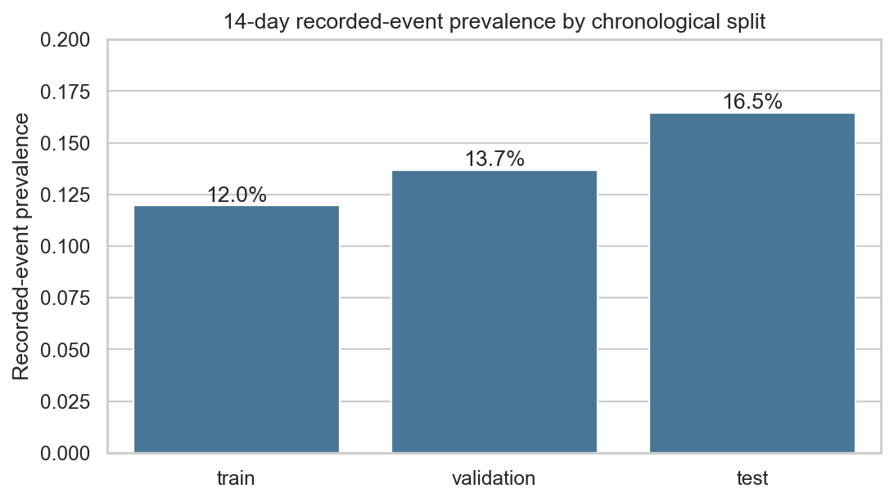
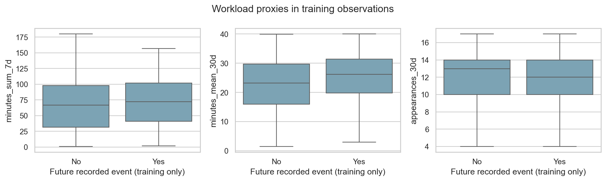
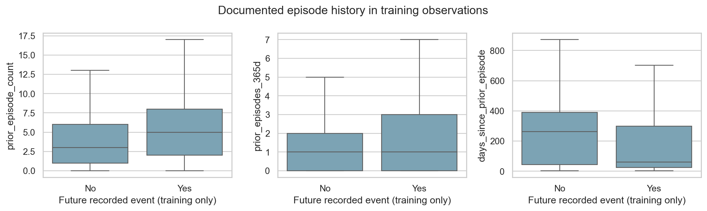
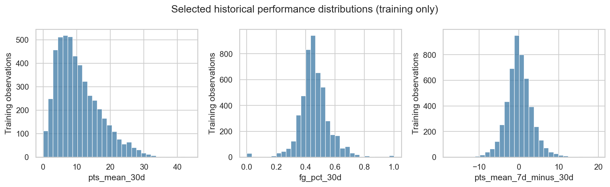
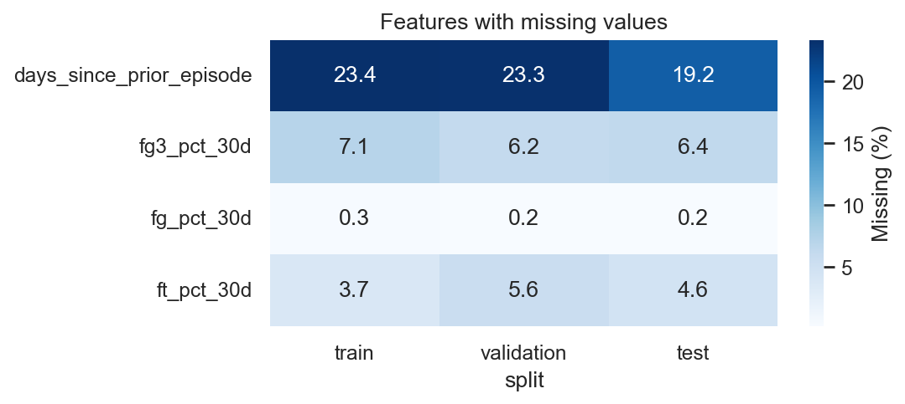
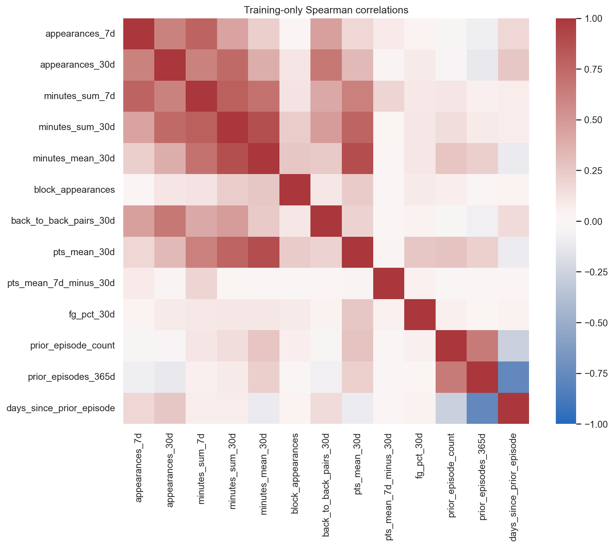

# Stage 3 historical features and exploratory analysis

Stage 3 implements **36 predictors** for the frozen 14-day recorded-event task: 14 workload proxies, 15 recent-performance summaries, and 7 documented episode-history features. All **9,804** Stage 2 observations and their labels/splits are preserved. No model, hyperparameter search, or real-data preprocessing transformation was fitted. The 7-day alternative remains unchanged for later sensitivity analysis.

This work supports historical feature engineering in Python and reusable scikit-learn preprocessing components. It does not establish new physiological injury onset or unbiased NBA-wide medical risk. The conditional cohort and ascertainment limitations in [the Stage 2 design](prediction_design.md) continue to apply.

## Feature families

| Group | Retained | Definitions |
| --- | ---: | --- |
| Workload | 14 | 7/14/30-day appearance counts, total minutes, average minutes, and back-to-back appearance pairs; observed-block cumulative appearances/minutes |
| Performance | 15 | 30-day means for points, rebounds, assists, steals, blocks, turnovers, fouls, plus/minus, FGA, 3PA, FTA; attempt-weighted FG/3P/FT proportions; 7-day minus 30-day mean points |
| Documented episode history | 7 | Earlier qualifying episode count, any-prior indicator, days since last episode, and prior counts over 30/90/180/365 days |

Every rolling window is **[historical cutoff − window days, historical cutoff)**. Its endpoint is the delayed historical cutoff, not the prediction date. Games are positive-minute appearances, matching the frozen source/eligibility convention. Workload windows and cumulative values are restricted to the current observed schedule block. Injury history uses earlier confirmed injury-related episodes from the Stage 2 audit since January 2009 and is not lifetime clinical history.

Back-to-back pairs require two observed appearance dates exactly one calendar day apart, with both inside the window. These are appearance-density proxies, not true rest, travel, training load, or DNP measures. Weighted shooting proportions use total makes divided by total attempts, instead of averaging rounded game percentages. Zero attempts or incomplete paired shooting data produce a missing proportion, not zero shooting ability. Performance means use observed values without zero-filling missing source statistics.

See the [feature dictionary](feature_dictionary.md), also saved as `results/tables/stage3_feature_dictionary.csv`, for each feature's name, source, timing, window, and units.

## Matrix dimensions and alignment

| Split | X dimensions | y dimensions | Positive outcomes | Prevalence |
| --- | --- | --- | ---: | ---: |
| Train | 4,957 × 36 | 4,957 × 1 | 593 | 11.9629% |
| Validation | 2,143 × 36 | 2,143 × 1 | 293 | 13.6724% |
| Test | 2,704 × 36 | 2,704 × 1 | 445 | 16.4571% |

`data/processed/stage3/X_{split}.csv` contains **only the 36 numeric predictors**, with no index/identity column. Matching `y_{split}.csv` contains only the 14-day outcome. `row_manifest_{split}.csv` preserves the row order, grouping identity, timestamps, and original target metadata separately. Do not concatenate that manifest into X. All row-level outputs remain ignored by Git.

Raw X retains missing values for preprocessing within later training folds. No imputed/scaled matrix or fitted model artifact is produced here. Cumulative appearance counts are independently recomputed from dated source rows and exactly match Stage 2's eligibility bookkeeping.

## Missingness and preprocessing design

Only four retained predictors have missing values:

| Feature | Train missing | Validation missing | Test missing | Meaning |
| --- | ---: | ---: | ---: | --- |
| `days_since_prior_episode` | 1,159 (23.38%) | 499 (23.29%) | 520 (19.23%) | No earlier confirmed documented episode |
| `fg3_pct_30d` | 352 (7.10%) | 132 (6.16%) | 174 (6.43%) | Zero three-point attempts in the window |
| `ft_pct_30d` | 185 (3.73%) | 120 (5.60%) | 125 (4.62%) | Zero free-throw attempts in the window |
| `fg_pct_30d` | 14 (0.28%) | 4 (0.19%) | 5 (0.18%) | Zero field-goal attempts in the window |

All other predictors are complete. The source-date audit finds no missing performance source values in the actual 30-day windows used for this cohort, and no incomplete paired shooting values. The observed missingness is structural. It is not evidence that the raw dataset is universally complete outside these windows.

The share without prior documented episodes varies from 22.71% in the 2018–19 block to 24.19% in the pre-interruption 2019–20 block, 23.29% in validation, and 19.23% in test. Three-point ratio missingness varies from 8.10% to 5.90% across the two training blocks. These are differences in available history, cohort composition, and attempts; they do not establish changes in health. Era-specific missingness is saved without test outcome associations.

`make_preprocessor()` returns an **unfitted sklearn Pipeline**:

1. A schema guard accepts exactly the named 36 numeric predictors and rejects labels, split/identity/date metadata, duplicate columns, and infinite values.
2. Median imputation learns statistics only within the later training fold. Existing `any_prior_episode`, episode counts, and attempt-mean columns identify the structural absence of history or attempts. A generic missingness indicator for episode recency would duplicate the any-prior flag, so it is not added.
3. Linear-model preprocessing applies StandardScaler to the numeric predictors. Tree preprocessing leaves them unscaled. No categorical encoder is needed because age/position/team/identity predictors are not included.

No transformations are fitted on validation or test. The unit test fits a tiny synthetic training fixture, transforms extreme held-out fixture values, and verifies that imputer/scaler statistics do not change. Real-data preprocessing is deliberately deferred to the model Pipeline so each future temporal CV fold learns its own medians/scales. No learned skew transformation, resampling, or data-driven test feature selection is introduced.

## Leakage checks and source provenance

The builder reads only observation ID, grouping player identity, index date, historical cutoff, and observed block start from each snapshot. It ignores labels, outcome/witness/availability dates, split membership, phase end/ID, and the existing eligibility count when constructing X. Player identity is used to retrieve history and is never a predictor.

Each row records source maxima for block workload, all 7/14/30-day workload windows, performance, all prior qualifying episodes, and the four injury windows in `source_date_audit.csv`. Every nonmissing maximum is strictly before that row's cutoff. Workload windows additionally validate their lower boundary. The cutoff itself is strictly before the index date.

Tests verify that inserting extreme games at the cutoff, on the prediction date, and later does not change X; that current/future episodes do not enter history; that changing all target-derived metadata does not change X; and that preprocessing rejects split/target/identity/date fields. They also verify weighted ratios, zero-attempt missingness, missing prior-event recency, back-to-back boundaries, invalid cutoff rejection, and ambiguous source dates.

The full 17-test suite passes: 8 Stage 2 tests plus 9 Stage 3 tests. Actual-data checks pass for nested workload/injury windows, shooting proportions in [0,1], bounded back-to-back counts, finite nonmissing values, and consistency of the any-prior indicator. Cloning a fitted sklearn preprocessor produces an unfitted instance for the next fold. Frozen Stage 2 files are hash-verified unchanged.

## Excluded features and redundancy

The builder computes 37 candidate features. `days_since_available_appearance` is always exactly **2** under the approved anchoring design and is excluded from X. This is an expected consequence of the frozen task, not a cohort bug. No retained predictor meets the audited near-zero-variance criterion: constant or dominant value fraction above 99.5% in training.

Explicit density columns equal appearance count divided by a fixed window length and would be perfectly redundant. Appearance counts already provide the density information. We keep one 30-day performance baseline and one short-term points contrast, rather than multiplying every statistic across all windows. Raw makes/sums and mean rounded percentages are not added alongside the weighted shooting ratios.

Training-only Spearman correlation flags six pairs with |rho| ≥ 0.90. The strongest include points/FGA means (0.968), mean minutes in 14/30 days (0.956), and prior counts in 90/180 days (0.937). They are retained as prespecified exposure/performance summaries, not asserted to be independent signals. Correlated features can affect coefficient stability and later importance attribution; future model comparisons should use the fixed set or make documented training-only changes.

Age, position, completed-season statistics, season games/starts, and prior-season minutes remain excluded because season conventions/lagged row selection have not been fully validated. Current unfinished-season totals are prohibited. Game-level starts, verified missed games/days, height/weight/BMI, biometrics, and travel/training exposure are not available for this pipeline. Neither player names nor IDs, test outcomes, split fields, or future ascertainment metadata enter X.

## Training-only descriptive EDA

Comparisons below use training rows only. Positive windows have median prior episode count **5**, versus **3** for negative windows. Among observations with earlier documented episodes, median time since the latest is **61 days** versus **263 days**; the corresponding available sample sizes are 520 and 3,278. Missing histories are not treated as zero elapsed days.

Mean minutes per available appearance over 30 days are **25.12** for positive windows versus **22.51** for negative windows. Median 7-day minutes are **72** versus **67**, while mean seven-day appearance counts are very similar (**2.83** versus **2.85**). Role/intensity and documentation may therefore matter descriptively more than the simple number of recent appearances, but no predictive effect or causal effect is established.

Mean 30-day points are **12.26** versus **10.27**. The seven-day minus thirty-day points contrast has means near zero in both groups (**0.072** versus **0.064**), giving little descriptive evidence of a large pre-event decline in this cohort. No statistical significance or model discrimination is inferred from these summaries.

The split prevalence rises from 11.96% to 13.67% to 16.46%, as already frozen in Stage 2. Reporting, selection, and calendar changes remain material. No test-target association, feature optimization, ROC-AUC, or PR-AUC was computed.








Boxplots omit outlier markers for readability but do not remove observations. Performance histograms use training data only. The correlation heatmap uses pairwise available values for a manageable 13-feature subset; the complete high-correlation table is saved separately.

## Examples without identity or target information

Five reproducible samples from training X are shown below. No player name, row identity, prediction date, split metadata, or target is included.

| Example | Appearances 7d | Minutes 7d | Mean minutes 30d | Weighted FG proportion 30d | Prior episodes | Days since prior episode |
| --- | ---: | ---: | ---: | ---: | ---: | ---: |
| 1 | 3 | 87 | 29.33 | 0.540 | 10 | 10 |
| 2 | 4 | 85 | 21.73 | 0.455 | 0 | missing |
| 3 | 3 | 85 | 24.31 | 0.450 | 1 | 2,369 |
| 4 | 4 | 74 | 18.86 | 0.344 | 0 | missing |
| 5 | 3 | 112 | 35.64 | 0.561 | 15 | 353 |

## Reproduction and stage boundary

Use a Python environment containing pandas, NumPy, scikit-learn, Matplotlib, and Seaborn, as listed in `requirements.txt`:

```bash
python scripts/build_stage3_features.py
python -m unittest discover -s tests -v
python scripts/verify_migration.py
git status --short
```

On the task computer, the available tested environment is the existing Anaconda Python: Python 3.13.5, pandas 2.2.3, NumPy 2.1.3, scikit-learn 1.6.1, Matplotlib 3.10.0, Seaborn 0.13.2. Its interpreter must be selected explicitly if shell `python3` resolves to a different installation. No packages or environments were installed/modified. Plot caches use writable temporary directories.

Created/modified paths are listed in [stage3_files.md](stage3_files.md). Features and row-level provenance remain local/ignored; reusable code, dictionaries, aggregate EDA tables, and figures are reviewable Git changes. Stage 2 source/design/splits are unchanged. No commit or push occurred. Stage 3 ends here; Stage 4 requires explicit approval.
