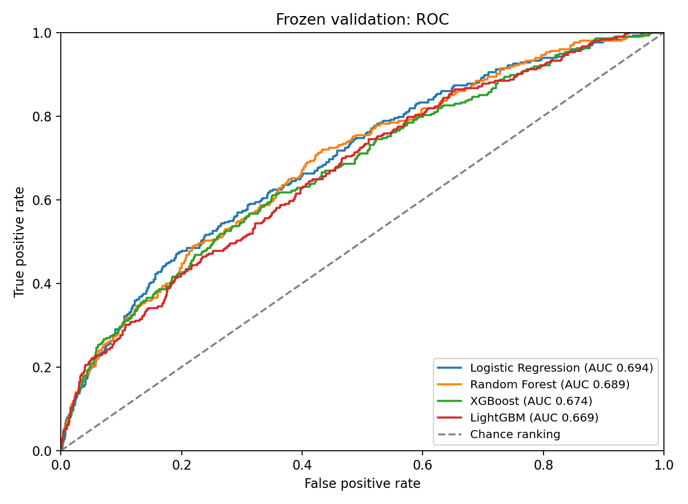
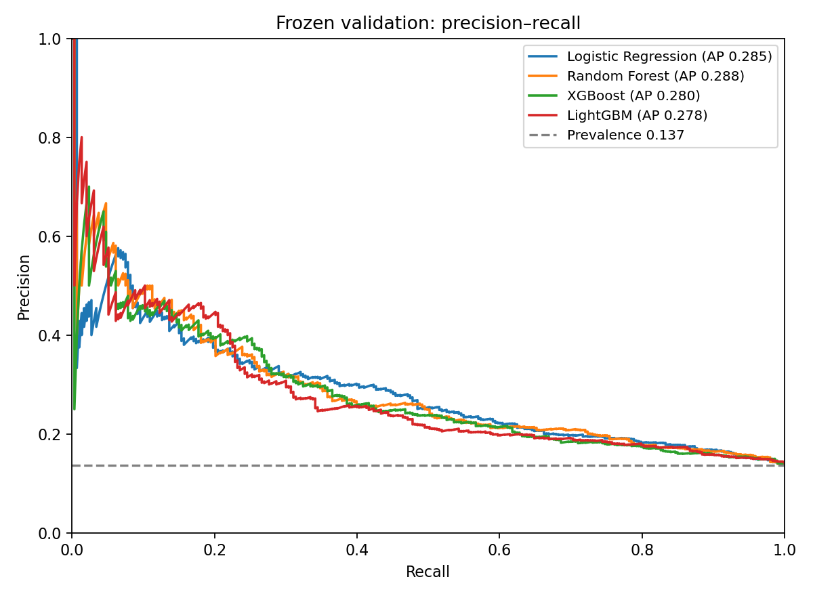

# Stage 4: fixed temporal baseline comparison

Four prescribed baseline configurations were fixed before fitting. No hyperparameter search, early stopping, feature selection, calibration, threshold optimization, or SMOTE was used. Stage 2/3 cohort and features are unchanged. **The held-out test matrices, labels, and manifests were never opened.**

## Population and preprocessing

Frozen training: 4,957 snapshots, 593 positives (11.96%), 2018-11-16–2020-02-27. Frozen validation: 2,143 snapshots, 293 positives (13.67%), 2021-01-22–2021-04-23. The task remains a documented new injury-related inactive-list episode in 14 days, conditional on the Stage 2 ascertainment/eligibility rules. All 36 Stage 3 numeric predictors are retained; player/date/target metadata never enter X.

Each fold has a fresh sklearn Pipeline with the Stage 3 schema guard and training-fold median imputation. Logistic Regression additionally uses training-fold StandardScaler; trees are not scaled. Full-training models learn preprocessing on training only and evaluate the frozen validation once each. No fitted models are persisted; the script reproduces the comparison.

## Temporal validation

Three fixed expanding chronological folds use only the frozen training period. Training index dates must be at least **23 calendar days** before the evaluation start, and `assumed_label_available_date_14d` must be strictly earlier than that start. This conservatively enforces the Stage 2 horizon/witness availability policy. No shuffled CV is used. Class weights and boosting `scale_pos_weight` are recomputed from each fold's training labels, never evaluation labels.

| fold | train_dates | eval_dates | train_n | train_positive | eval_n | eval_positive | purged | train_negative_positive_ratio | latest_train_label_available |
| --- | --- | --- | --- | --- | --- | --- | --- | --- | --- |
| 1 | 2018-11-16–2018-12-09 | 2019-01-01–2019-02-28 | 630 | 71 | 1251 | 135 | 190 | 7.8732 | 2018-12-28 |
| 2 | 2018-11-16–2019-02-06 | 2019-03-01–2019-03-28 | 1570 | 170 | 633 | 84 | 501 | 8.2353 | 2019-02-25 |
| 3 | 2018-11-16–2019-03-28 | 2019-11-22–2020-02-27 | 2704 | 310 | 2253 | 283 | 0 | 7.7226 | 2019-04-12 |

CV metrics are the unweighted mean across three folds; sample standard deviations and all CV precision/recall/F1 values are in the single comparison CSV. They describe temporal variability, not independent-sample confidence intervals. Repeated players across periods are allowed for future-time prediction; these results do not establish generalization to entirely unseen players.

## Baseline settings and imbalance

- **Logistic Regression**: `{'C': 1.0, 'solver': 'lbfgs', 'max_iter': 1000, 'class_weight': 'balanced', 'random_state': 42}`
- **Random Forest**: `{'n_estimators': 200, 'max_depth': 8, 'min_samples_leaf': 5, 'max_features': 'sqrt', 'class_weight': 'balanced', 'n_jobs': 4, 'random_state': 42}`
- **XGBoost**: `{'n_estimators': 150, 'max_depth': 3, 'learning_rate': 0.05, 'min_child_weight': 5, 'subsample': 1.0, 'colsample_bytree': 1.0, 'reg_lambda': 1.0, 'tree_method': 'hist', 'objective': 'binary:logistic', 'eval_metric': 'logloss', 'n_jobs': 4, 'random_state': 42, 'scale_pos_weight': 7.359190556492411}`
- **LightGBM**: `{'n_estimators': 150, 'max_depth': 4, 'num_leaves': 15, 'learning_rate': 0.05, 'min_child_samples': 20, 'reg_lambda': 1.0, 'subsample': 1.0, 'colsample_bytree': 1.0, 'objective': 'binary', 'n_jobs': 4, 'random_state': 42, 'verbosity': -1, 'scale_pos_weight': 7.359190556492411}`

All unlisted parameters use installed-library defaults. Logistic Regression/Random Forest use `class_weight="balanced"`; boosted models use training negatives/positives, **4364/593 = 7.359191** for the final training fit. Probability cutoffs for every precision/recall/F1 calculation are fixed at **0.5**. These class-weighted scores are uncalibrated; they are not established clinical injury probabilities. See [XGBoost API](https://xgboost.readthedocs.io/en/stable/python/python_api.html) and [LightGBM API](https://lightgbm.readthedocs.io/en/stable/pythonapi/lightgbm.LGBMClassifier.html) for weight semantics.

## Comparison

PR-AUC is reported as **Average Precision (AP)**, not trapezoidal area under the interpolated PR curve. The primary comparison criterion was frozen-validation AP, selected before fitting.

| model | cv_roc_auc_mean | cv_average_precision_mean | validation_roc_auc | validation_average_precision | validation_precision | validation_recall | validation_f1 |
| --- | --- | --- | --- | --- | --- | --- | --- |
| Logistic Regression | 0.6245 | 0.1811 | 0.6937 | 0.2852 | 0.2256 | 0.5904 | 0.3264 |
| Random Forest | 0.6272 | 0.1783 | 0.6888 | 0.2879 | 0.3220 | 0.2901 | 0.3052 |
| XGBoost | 0.5831 | 0.1654 | 0.6737 | 0.2803 | 0.2338 | 0.5188 | 0.3224 |
| LightGBM | 0.5720 | 0.1678 | 0.6693 | 0.2783 | 0.2476 | 0.4334 | 0.3151 |

**Highest validation AP: Random Forest.** Validation no-skill AP reference is its prevalence, 0.1367. Selection remains provisional until a later approved final test evaluation. The old course ROC-AUC uses a different outcome/population/random split and cannot serve as an improvement comparator.

Per-fold results (same fixed configurations; no searches):

| model | fold | roc_auc | average_precision | precision | recall | f1 | seconds |
| --- | --- | --- | --- | --- | --- | --- | --- |
| Logistic Regression | 1 | 0.5958 | 0.1460 | 0.1164 | 0.9185 | 0.2067 | 0.0384 |
| Logistic Regression | 2 | 0.6597 | 0.2003 | 0.2044 | 0.4405 | 0.2792 | 0.0419 |
| Logistic Regression | 3 | 0.6179 | 0.1969 | 0.1731 | 0.5371 | 0.2618 | 0.0472 |
| Random Forest | 1 | 0.5891 | 0.1442 | 0.1915 | 0.0667 | 0.0989 | 0.1899 |
| Random Forest | 2 | 0.6661 | 0.2087 | 0.1538 | 0.0238 | 0.0412 | 0.1687 |
| Random Forest | 3 | 0.6263 | 0.1820 | 0.1838 | 0.2403 | 0.2083 | 0.2079 |
| XGBoost | 1 | 0.5446 | 0.1276 | 0.1220 | 0.2963 | 0.1728 | 0.0497 |
| XGBoost | 2 | 0.6187 | 0.1951 | 0.2182 | 0.1429 | 0.1727 | 0.0478 |
| XGBoost | 3 | 0.5861 | 0.1735 | 0.1714 | 0.3816 | 0.2366 | 0.0487 |
| LightGBM | 1 | 0.5395 | 0.1295 | 0.1342 | 0.2296 | 0.1694 | 0.0314 |
| LightGBM | 2 | 0.6060 | 0.1982 | 0.2500 | 0.1310 | 0.1719 | 0.0374 |
| LightGBM | 3 | 0.5706 | 0.1756 | 0.1670 | 0.3004 | 0.2146 | 0.0359 |





## Sanity checks and runtime

All 16 fits succeeded (three CV and one full-training fit per model). All probabilities are finite and within [0,1]; imputation/scaling statistics do not change during held-out prediction. Fold ordering, 23-day separation, training-label availability, frozen row counts/positive counts/schema/alignment, and unchanged six input-file SHA-256 values passed runtime assertions. The read allowlist admits only train/validation X, y, and manifests. No Stage 4 test suite was added; Stage 2/3 source code was not modified.

Measured script runtime: **1.78 seconds**, excluding imports, package installation, and document review. Per-model fitting/prediction times are in the comparison CSV. Python: 3.13.5; packages: `{'numpy': '2.1.3', 'pandas': '2.2.3', 'scipy': '1.15.3', 'scikit-learn': '1.6.1', 'matplotlib': '3.10.0', 'xgboost': '3.4.1', 'lightgbm': '4.7.0'}`. XGBoost and LightGBM installed from precompiled wheels in ignored `.venv-stage4`, using existing Anaconda scientific packages; no global package changes.

## Outputs and reproduction

- `results/tables/stage4_model_comparison.csv`: the only comparison table (CV mean/SD for five metrics, validation five metrics, timing).
- `results/figures/stage4/roc.png` and `precision_recall.png`: validation curves only.
- `data/processed/stage4/validation_predictions.csv`: 2,143 validation observations with IDs, dates, truth, four scores and four fixed-threshold predictions; local and ignored by Git.
- `scripts/run_stage4_baselines.py`, `requirements-stage4.txt`, and this report: fixed settings, split definitions, checks, and reproduction.
- Existing `.gitignore` and `README.md` updated for the local environment and Stage 4 status. No Stage 2/3 data, scripts, feature rules, or split definitions modified.

From the repository root:

```bash
/opt/anaconda3/bin/python3 -m venv --system-site-packages .venv-stage4
.venv-stage4/bin/python -m pip install --only-binary=:all: --no-deps xgboost==3.4.1 lightgbm==4.7.0
.venv-stage4/bin/python scripts/run_stage4_baselines.py
git status --short
```

The tested existing scientific dependency versions are listed in `requirements-stage4.txt`; a new isolated environment can install that file instead. If LightGBM import is unavailable, the script explicitly reports its skip reason and runs the other three models.

## Remaining limits

This benchmark conditions on retrospective label ascertainment/follow-up and appearance-based eligibility. Injury logs do not establish physiological onset, a continuously active roster, causal workload effects, or calibrated risk. Reporting differences and repeated-player dependence remain. No uncertainty intervals or detailed diagnostics were added in this streamlined stage. Résumé claims may describe four-model temporal comparison and validation results, with the recorded-event task specified; do not call these test results or clinical injury prediction accuracy.

Stage 4 ends here. No tuning, Stage 5 work, held-out test evaluation, commits, or remote push was performed.
